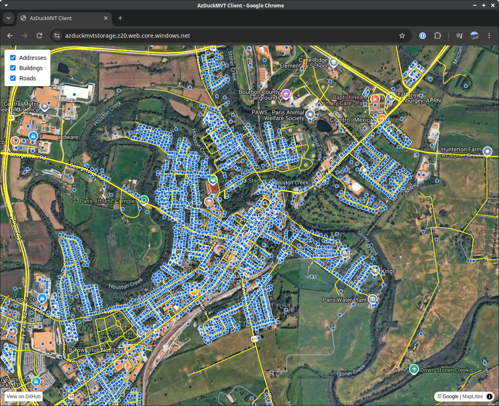

I gave a talk at [FOSS4GNA](https://foss4gna.org) 2026 in Sacramento that demonstrated how to build a vector tile delivery API using DuckDB, GeoParquet, and Azure Storage+Functions. It is entirely serverless in its architecture and cloud native in its data approach. The talk outlined how to build a vector tile delivery API using DuckDB, GeoParquet, and Azure Functions+Storage. It focused on doing so with large data sets (100+ million rows) that cross thousands of GeoParquet files requiring a number of indexing, filtering, and pruning approaches to ensure acceptable response times for tile generation. All aspects were covered including GeoParquet file creation optimization (file sizes, row group sizes, geographic grouping), query optimization within DuckDB, and API design.

||
|:--:|
| *Demo web app for the azduckmvt project* |

The [repository](https://github.com/jesseamundsen/azduckmvt) has been made publicly available. The slides from the talk are available as a PDF. The data acquisition and GeoParquet file generation approach was written purely in DuckDB utilizing demo data of census tiger roads, overture buildings, and address points from the National Address Database. Also available is a working Azure Function API example with optimized DuckDB query using file-based bounding box pre-filtering. Finally, a demo web app using MapLibre provides a way to query and visualize the data from the API.